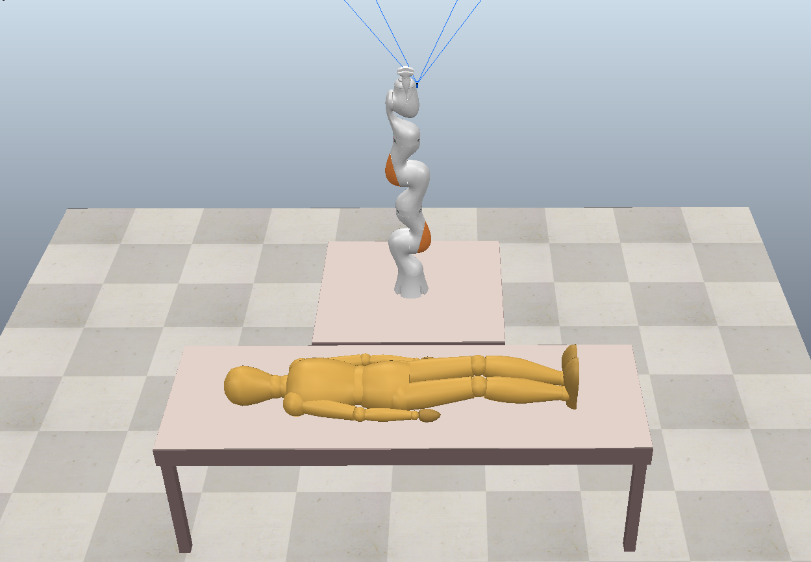
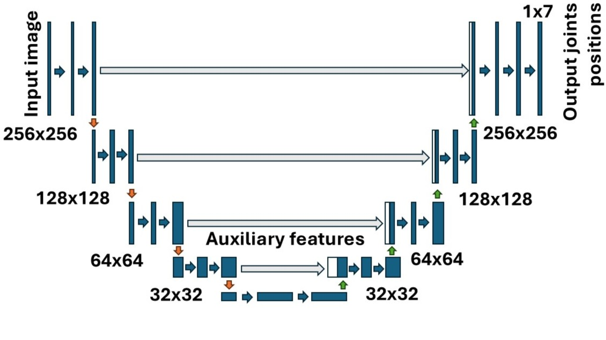

# Student-Conference Submission
*Simulation Framework for a Collision Avoidance Inverse Kinematics model of a 7 degrees of freedom Ultrasound Imaging Robot*

Existing inverse kinematics models focus on solely guiding robot movements. However, there is insufficient research on such models that allow prevention of unwanted collisions with patients during ultrasound imaging procedures. To address this challenge, and avoid the need for ground-truth data, a Reinforcement Learning (RL) approach is chosen. This allows the robot to learn how to avoid collisions in real-time when the patient moves.

This work develops a simulation framework collision-avoidance inverse kinematics model for a 7-DoF KUKA robot. This robot is used for ultrasound imaging of patients at the Institute of Robotics and Cognitive Systems, as depicetd in the Figure. 

Proximal Policy Optimization (PPO) RL algorithm is utilized to train the kinematics model. CoppeliaSim ia used for  environment simulation in conjunction with PyTorch. Observations from the environment are obtained through a camera attached to the robot’s end-effector. The captured image serves as data input of the algorithm.

|Libraries|Version|
|---------|--------|
|gym|0.17.1|
|gym-notices|0.0.8|
|torch|2.5.1|
|torchaudio|2.0.1+cu118|
|torchrl|0.6.0|
|torchvision|0.20.1|
